<div align="center">

# 🐧 Data Preprocessing
### De datos originales a características listas para Machine Learning

**Inteligencia Artificial · Universidad Politécnica Salesiana**


**Autor:** [Josue Vele](https://github.com/JosueVele77)

[](https://colab.research.google.com/github/JosueVele77/data-preprocessing/blob/main/Practica_2_Prepocesamiento_de_datos.ipynb)

[📒 Explorar notebook](./Practica_2_Prepocesamiento_de_datos.ipynb) · [📚 Dataset Palmer Penguins](https://huggingface.co/datasets/SIH/palmer-penguins)

</div>

---

## 📌 Descripción

Este repositorio contiene una práctica de **preprocesamiento de datos para aprendizaje automático**: identificar instancias, atributos, *features* y *labels*; explorar tipos de variables; limpiar datos; y comprobar cómo funcionan tres métodos de escalado.

Se utiliza un dataset didáctico de **seis estudiantes** y un conjunto real, **Palmer Penguins**, procesado en Google Colab con Python, NumPy, Pandas, Matplotlib y Scikit-learn. El propósito es preparar y entender los datos, **no entrenar un clasificador**.

## 🧭 Flujo de trabajo


> **Buena práctica:** separar los datos de entrenamiento y prueba **antes** de ajustar los escaladores, para evitar *data leakage*.

## 📖 Contenido por fases

| Fase | Trabajo realizado | Evidencias |
|:---:|---|---|
| **1** | Anatomía de un dataset | Instancias, atributos, features/label, tipos de datos y `describe()` |
| **2** | Escalado manual con NumPy | Min-Max, Z-Score, gráficas y simulación de outliers |
| **3** | Dataset Palmer Penguins | Valores nulos, limpieza, estadísticas y escalado |
| **4** | Hugging Face + Scikit-learn | `train_test_split`, tres escaladores y verificaciones manuales |

## 📐 Métodos de escalado

| Método | Fórmula | Característica |
|---|---|---|
| **Min-Max** | `(x - min) / (max - min)` | Ajusta los datos de entrenamiento al intervalo **[0, 1]** |
| **Z-Score** | `(x - media) / std` | Centra los datos de entrenamiento en media **0** y desviación estándar **1** |
| **RobustScaler** | `(x - mediana) / IQR` | Utiliza mediana y rango intercuartílico; reduce la sensibilidad a outliers |

### 📊 Impacto de un outlier: distancia de Carlos

En la fase 2, Carlos vive a **40,2 km**. Al añadir un estudiante que vive a **120 km** y **volver a ajustar** los escaladores, su representación cambia:

| Método | Sin outlier | Con outlier |
|---|---:|---:|
| Min-Max | 1.0000 | 0.3305 |
| Z-Score | 2.0997 | 0.3201 |
| RobustScaler | 3.2409 | 1.3235 |

```mermaid
xychart-beta
    title "Carlos: valores escalados antes y después"
    x-axis ["Min-Max", "Z-Score", "Robust"]
    y-axis "Valor transformado" 0 --> 3.5
    bar [1.0000, 2.0997, 3.2409]
    bar [0.3305, 0.3201, 1.3235]
```



**Cómo interpretar las barras:** la primera serie corresponde a *sin outlier* y la segunda a *con outlier*. La comparación muestra el efecto de volver a ajustar cada técnica; los valores de los distintos métodos **no tienen por qué compartir la misma escala**. RobustScaler es más resistente, pero no invariable.

### 📈 Visualización del notebook

La **Actividad 2.4** crea con Matplotlib una cuadrícula de **3 × 3 gráficos** que compara `promedio_gpa`, `horas_estudio` y `distancia_km` en sus formas original, Min-Max y Z-Score. El código genera el archivo `comparacion_escalado.png` durante su ejecución en Colab.

> Para incluir la imagen PNG dentro del repositorio, primero debes descargarla desde Colab y subirla; el archivo README no presupone que la imagen ya exista en GitHub.

## 🐧 Dataset real: Palmer Penguins

**Origen:** [SIH/palmer-penguins en Hugging Face](https://huggingface.co/datasets/SIH/palmer-penguins).

La guía de la práctica indica **344 registros originales** y **333 filas completas** después de `dropna()`.

| Feature numérica | Unidad | Significado |
|---|---|---|
| `bill_length_mm` | mm | Longitud del pico |
| `bill_depth_mm` | mm | Profundidad del pico |
| `flipper_length_mm` | mm | Longitud de la aleta |
| `body_mass_g` | g | Masa corporal |

La columna `species` es una posible **etiqueta de clasificación**, aunque este notebook se centra en el preprocesamiento.

## 🛠️ Herramientas

- 🐍 **Python:** implementación de la práctica.
- 🔢 **NumPy:** cálculos con matrices, medias, desviaciones y percentiles.
- 🐼 **Pandas:** exploración, limpieza y estadísticas tabulares.
- 📉 **Matplotlib:** gráficos de comparación.
- 🤖 **Scikit-learn:** `MinMaxScaler`, `StandardScaler`, `RobustScaler` y `train_test_split`.
- ☁️ **Google Colab:** ejecución interactiva sin configuración local.
- 🐧 **Hugging Face:** fuente del dataset Palmer Penguins.

## ▶️ Cómo ejecutar

1. Abre el notebook con el botón **Abrir en Colab** al inicio.
2. Elige **Entorno de ejecución → Ejecutar todas**.
3. Revisa las salidas, gráficas y comparaciones de cada fase.
4. Guarda una copia del notebook con las salidas si necesitas conservar la evidencia.

**Requisitos:** Python, `numpy`, `pandas`, `matplotlib` y `scikit-learn`; Colab suele incluir estas dependencias. Es necesaria conexión a Internet para cargar el CSV de Hugging Face.

## 🧪 Comprobaciones numéricas

Las comparaciones emplean **el mismo conjunto de entrenamiento** para contrastar implementaciones manuales y escaladores de Scikit-learn.

```python
np.allclose(min_train, mm_scaler.data_min_)
np.allclose(max_train, mm_scaler.data_max_)
np.allclose(X_train_mm_manual, X_train_mm)
np.allclose(X_train_z_manual, X_train_zs)
np.isclose(mediana_manual, rb_scaler.center_[3])
np.isclose(iqr_manual, rb_scaler.scale_[3])
```

> Este fragmento resume las verificaciones: las variables se definen en las celdas anteriores del notebook, y no se debe ejecutar aislado.

## 💡 Conclusiones

1. Identificar correctamente el tipo de cada variable permite elegir qué atributos son útiles como entradas de un modelo.
2. Min-Max, Z-Score y RobustScaler modifican las magnitudes sin alterar el orden relativo; sin embargo, los valores extremos afectan de manera distinta sus parámetros.
3. Explorar, limpiar y dividir los datos antes de ajustar transformaciones es esencial para obtener resultados reproducibles y evitar fuga de información.

## ✅ Recomendaciones

1. Revisar tipos, datos faltantes y posibles valores atípicos antes de cualquier escalado.
2. Elegir el escalador según el dataset y las necesidades del algoritmo; no usar uno por defecto en todos los casos.
3. Ajustar con `X_train`, transformar `X_test` con el mismo escalador y validar los cálculos manuales frente a Scikit-learn.

## 📁 Estructura del repositorio

```text
data-preprocessing/
├── README.md
└── Practica_2_Prepocesamiento_de_datos.ipynb
```

## 🔗 Referencias

- [Documentación de preprocesamiento de Scikit-learn](https://scikit-learn.org/stable/modules/preprocessing.html)
- [Documentación de NumPy](https://numpy.org/doc/stable/)
- [Documentación de Pandas](https://pandas.pydata.org/docs/)
- [Palmer Penguins, Hugging Face](https://huggingface.co/datasets/SIH/palmer-penguins)

---

<div align="center">

**Hecho con Python y curiosidad por Machine Learning** 🐍

[⬆️ Volver al inicio](#-data-preprocessing)

</div>
